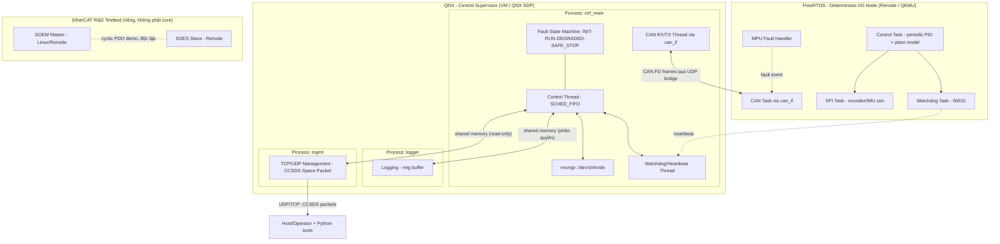

# Architecture — QNX–FreeRTOS Real-Time Control Bridge

## 1. Sơ đồ tổng thể



## 2. QNX — Central Supervisor

### 2.1 Resource Manager
- Đăng ký device node `/dev/ctrlnode` bằng `resmgr_attach`.
- Expose `devctl()` interface cho các lệnh: `SET_MODE`, `GET_STATUS`, `GET_TELEMETRY`, `EMERGENCY_STOP`.
- Input validation chặt ở `devctl` handler (bounds check buffer, reject payload sai kích thước) — tránh lỗi tràn bộ đệm (OWASP: input validation tại boundary).

### 2.2 Process & thread

Hệ thống tách thành 3 process để minh họa memory protection thật (mỗi process có address space riêng, quyền truy cập shared memory khác nhau):

| Process | Quyền truy cập shared memory | Vai trò |
|---|---|---|
| `ctrl_main` | Đọc/ghi vùng state & telemetry | Điều khiển chính, resmgr, CAN, watchdog |
| `logger` | Chỉ đọc vùng state, ghi vùng log riêng | Ghi log ring-buffer (phục vụ traceability) |
| `mgmt` | Chỉ đọc vùng telemetry | Giao tiếp với operator qua TCP/UDP |

Thread trong `ctrl_main`:

| Thread | Priority/Policy | Nhiệm vụ |
|---|---|---|
| Control Thread | `SCHED_FIFO`, cao | Vòng điều khiển chính, đọc/ghi trạng thái qua IPC |
| CAN RX/TX Thread | `SCHED_FIFO`, trung bình | Gửi lệnh, nhận telemetry/heartbeat từ FreeRTOS node qua `can_if` |
| Watchdog/Heartbeat Thread | `SCHED_FIFO`, cao | Theo dõi heartbeat từ FreeRTOS, kích hoạt fail-safe nếu mất tín hiệu |

### 2.3 IPC
- Giao tiếp giữa Control Thread ↔ Watchdog (cùng process) và giữa `ctrl_main` ↔ `logger`/`mgmt` (khác process): QNX **channel + `MsgSend`/`MsgReceive`/`MsgReply`**.
- Sự kiện định kỳ: `timer_create()` với `SIGEV_PULSE` gửi pulse vào channel của Control Thread.
- Dữ liệu lớn/tần suất cao (state, telemetry mới nhất, log) đi qua **shared memory object** (`shm_open` + `mmap`) với quyền khác nhau cho từng process (`PROT_READ` / `PROT_READ|PROT_WRITE`). Ghi sai vào vùng read-only trong `logger`/`mgmt` gây fault, được test như một case fault-injection.

### 2.4 Fault handling — State Machine
```
INIT -> RUN -> DEGRADED -> SAFE_STOP
  ^              |             |
  |______________|_____________|
        (reset sau khắc phục)
```
- `RUN → DEGRADED`: mất 1 vài chu kỳ heartbeat hoặc CRC lỗi vượt ngưỡng.
- `DEGRADED → SAFE_STOP`: mất heartbeat liên tục N chu kỳ, hoặc lệnh `EMERGENCY_STOP` từ operator.
- Mọi transition được ghi log có timestamp (phục vụ traceability/audit — yêu cầu chuẩn thiết bị y tế).

## 3. FreeRTOS — Deterministic I/O Node

### 3.1 Task structure
| Task | Chu kỳ | Nhiệm vụ |
|---|---|---|
| Control Task | Cố định (vd 1kHz) | Vòng PID điều khiển vị trí/tốc độ motor trên plant model mô phỏng, đọc encoder qua SPI |
| CAN Task (qua `can_if`) | Event-driven + định kỳ heartbeat | Nhận lệnh từ QNX, gửi telemetry/heartbeat |
| SPI Task | Theo yêu cầu Control Task | Đọc encoder/IMU giả lập |
| Watchdog Task | Định kỳ ngắn | Kick IWDG, giám sát các task khác còn sống (task health check) |

### 3.2 Vòng điều khiển PID & plant model
- Plant model: motor DC bậc nhất/bậc hai (hằng số thời gian, quán tính cấu hình được), tích phân theo chu kỳ Control Task.
- Encoder giả (đọc qua SPI task) = vị trí plant + nhiễu lượng tử hóa/Gaussian.
- PID có anti-windup, giới hạn output, giới hạn tốc độ thay đổi (rate limit) — các giới hạn này kích hoạt SAFE_STOP khi vi phạm.
- Python script chạy test step response, vẽ đồ thị (overshoot, settling time) làm bằng chứng cho README.

### 3.3 Fault handling
- **MPU Fault Handler**: bắt lỗi truy cập bộ nhớ trái phép (memory fault ISR), log nguyên nhân, chuyển motor về trạng thái an toàn (dừng PWM) trước khi reset.
- **IWDG Watchdog**: nếu Control Task hoặc CAN Task treo, watchdog không được kick → reset node, QNX phát hiện qua mất heartbeat.
- **CRC/checksum** trên mọi khung CAN FD gửi đi — frame lỗi bị discard, tăng counter lỗi, không thực thi lệnh sai.

## 4. Giao thức CAN FD (định nghĩa bằng file DBC)

- File `can_matrix.dbc` là nguồn sự thật duy nhất (single source of truth).
- Script Python (`cantools`) sinh header C dùng chung cho QNX và FreeRTOS, đồng thời dùng cho test giải mã frame.
- Lớp `can_if` (HAL): `can_if_init()`, `can_if_send()`, `can_if_recv()`. Backend: `udp_bridge` (mặc định, CAN bus ảo), `fdcan` (STM32, nếu Renode hỗ trợ hoặc có board), `devc-can` (QNX, phần cứng thật).

| CAN ID | Hướng | Payload | Mô tả |
|---|---|---|---|
| 0x100 | QNX → FreeRTOS | `[cmd_type][target_pos][speed][crc]` | Lệnh điều khiển motor |
| 0x101 | FreeRTOS → QNX | `[encoder_pos][sensor_val][fault_flags][crc]` | Telemetry phản hồi |
| 0x1FF | FreeRTOS → QNX | `[seq_no][node_status][crc]` | Heartbeat định kỳ |
| 0x000 | QNX → FreeRTOS | `[EMERGENCY_STOP_MAGIC][crc]` | Lệnh dừng khẩn, ưu tiên cao nhất (ID thấp nhất) |

## 5. EtherCAT R&D Testbed (phụ, tách biệt)
- Chạy độc lập trên một testbed Linux (hoặc Renode riêng), **không tích hợp vào luồng chính** của QNX/FreeRTOS bridge.
- Master: SOEM chạy trên Linux, Slave: SOES chạy trên Renode (giả lập STM32).
- Slave PDO dùng chung state machine `INIT→RUN→SAFE_STOP` và định nghĩa fault với hệ thống chính, để có thể so sánh hành vi giữa CAN FD và EtherCAT.
- Mục tiêu: chứng minh hiểu cơ chế cyclic PDO exchange của EtherCAT, đánh giá khả năng tích hợp trong tương lai — trình bày trung thực là "nghiên cứu/thử nghiệm riêng", không claim chạy production trên QNX.

## 6. Công cụ mô phỏng (do không có board)
| Thành phần | Công cụ | Ghi chú |
|---|---|---|
| QNX | QNX SDP (giấy phép miễn phí cá nhân/học tập) trên VirtualBox | Có target ảo x86/qemu kèm theo |
| FreeRTOS | Renode (Antmicro, mã nguồn mở) mô phỏng STM32 | Cần xác minh ở M1: Renode có model FDCAN/MCAN cho target dùng hay không (bxCAN chỉ là CAN classic). Fallback: QEMU MPS2-AN385 + backend UDP |
| CAN FD kết nối 2 "máy" | Cầu nối qua UDP (giữa VM QNX và Renode) đóng vai "CAN bus ảo" | Document rõ đây là lớp bridge mô phỏng; QNX VM không có CAN controller thật |

## 7. Telemetry/Management — CCSDS Space Packet
- `mgmt` process đóng gói telemetry theo CCSDS Space Packet (primary header 6 byte: version, type, secondary header flag, APID, sequence flags, sequence count, packet data length).
- APID phân biệt: telemetry motor, trạng thái state machine, log sự kiện lỗi; secondary header chứa timestamp.
- Lệnh từ operator (Python tool) cũng dùng Space Packet (telecommand), được validate độ dài/APID/sequence tại boundary trước khi chuyển vào `ctrl_main`.

## 8. Bộ công cụ Python
| Công cụ | Chức năng |
|---|---|
| `dbc_codegen.py` | Sinh header C từ `can_matrix.dbc` bằng `cantools` |
| `can_decode.py` | Giải mã/capture frame trên UDP bridge để debug |
| `ccsds_client.py` | Gửi telecommand, nhận/giải mã telemetry Space Packet |
| `fault_inject/` | Test pytest/Robot Framework điều khiển Renode: ngắt CAN, sai CRC, treo task |
| `log_analyzer.py` | Phân tích log ring-buffer, tính latency, đếm transition state machine |
| `step_response.py` | Chạy kịch bản PID, vẽ đồ thị overshoot/settling time |
