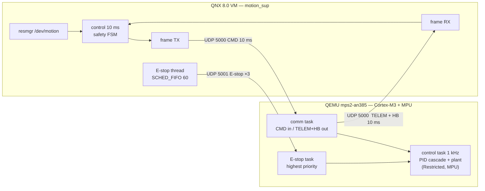

# QNX–FreeRTOS Safety-Supervised Motion Control Platform (SIL)

[](https://github.com/TranVanL/RTOS/actions/workflows/ci.yml)

A two-node motion-control system validated by **Software-in-the-Loop** (no real board): a **QNX 8.0 supervisor** (VM) and a **FreeRTOS motion node** (QEMU Cortex-M3 + MPU), linked by **CAN FD-compatible frames over UDP** with **AUTOSAR E2E Profile 4–based** protection and a safety state machine on each side.



## Features
- **FreeRTOS motion node** (QEMU `mps2-an385`, Cortex-M3, `ARM_CM3_MPU` + FreeRTOS+TCP): 1 kHz cascade PID with DC-motor plant and encoder models, control task running unprivileged under the MPU, dedicated highest-priority E-stop task, node safety FSM with a 50-tick command timeout.
- **QNX supervisor** (QNX SDP 8.0 VM): `motion_sup` with six threads (SCHED_FIFO 60/55/50/45/45 + SCHED_RR 20 resmgr) and timer pulses, `/dev/motion` resource manager with group-based `EPERM`/`EINVAL` checks, `motionctl` client, `logger`/`mgmt` processes on read-only shared memory (seqlock, intentional `SIGSEGV` isolation), child-crash detection, priority inheritance demonstrated with and without PI.
- **Protocol:** CAN FD-compatible frames over UDP, payloads generated from one DBC file, AUTOSAR E2E Profile 4–based header (length, counter, data ID, CRC-32P4); E-stop on its own port, sent three times.
- **Safety FSMs on both sides** (INIT → READY → RUN → DEGRADED → SAFE_STOP), written as OS-free C and unit-tested on the host.
- **Test tooling:** C host suites (CTest), Python reference codec and frame sniffer, Python supervisor stand-in that runs the node firmware in QEMU, `metrics.py` for jitter, round-trip latency and reaction ticks, QNX VM scripts for the end-to-end runs.
- **Traceability:** requirements → design → code → test in [docs/traceability_matrix.md](docs/traceability_matrix.md), with a safety concept in the spirit of ISO 26262.

### Key results (SIL: QNX VM + QEMU — deterministic criteria use tick/frame counts, never milliseconds)
| Behaviour | Criterion | Result |
|---|---|---|
| 30 min closed loop QNX ↔ node | 180 000 supervisor ticks, 0 E2E errors, FSM stays RUN | **pass** |
| E-stop (3 copies on a dedicated port) | node output disabled ≤ 1 control tick after the E-stop task accepts the frame | **1 tick** |
| `kill -9 motion_sup` while RUN | node disables itself exactly 50 of its own ticks after the last CMD | **50 ticks** (DEGRADED at 25) |
| Round trip CMD → telemetry echo (QNX clock only) | informational | p50 ≈ 5.5 ms, p99 ≈ 10.3 ms, max ≈ 28 ms (179 301 samples) |
| Control-task jitter (QEMU `-icount`, virtual time) | informational | p99 = 0…4 counts of 25 MHz at 3 load levels |

## Repository layout
```
common/    OS-free C: frame, E2E, DBC-generated pack/unpack, safety FSMs, SHM seqlock, control core
qnx/       motion_sup, logger, mgmt, motionctl, QNX test programs
freertos/  node firmware (ARM_CM3_MPU + FreeRTOS+TCP), submodules for kernel and TCP stack
tools/     dbc_codegen, metrics, Python supervisor stand-in, QNX VM scripts, pytest suites
tests/     host CTest suites (protocol, control, safety)
docs/      overview, architecture, requirements, safety concept, traceability, results
```
`common/can_matrix.dbc` is the single source of truth for message payloads; `common/generated/` is generated, never hand-edited.

## Build and run
```bash
git clone --recurse-submodules https://github.com/TranVanL/RTOS.git && cd RTOS
pip install -r tools/requirements.txt
python tools/dbc_codegen.py --check          # generated code is up to date
python -m pytest tools -q                    # host tests (+ node-in-QEMU tests if arm-none-eabi-gcc and qemu-system-arm are installed)

# Node firmware (ARM). Presets: node_m4_host (QEMU user networking), node_m4_qnx (QNX VM link)
cmake --preset node_m4_host -S freertos && cmake --build build/freertos_m4_host
```
Node in QEMU against the Python supervisor stand-in (no QNX needed): see `tools/sil_supervisor.py` and `tools/tests/test_m4_node_qemu.py`.
QNX end-to-end (needs a QNX SDP 8.0 VM, see [docs/sil_environment.md](docs/sil_environment.md)): `tools/qnxvm/run_m4.sh A B C` and `tools/qnxvm/run_m4.sh long 30`.

## Documentation
[Overview](docs/00_PROJECT_OVERVIEW.md) · [Architecture](docs/01_ARCHITECTURE.md) · [Requirements](docs/requirements.md) · [Safety concept](docs/safety_concept.md) · [Traceability](docs/traceability_matrix.md) · [SIL environment](docs/sil_environment.md) · [End-to-end results](docs/m4_plan.md). Design documents are written in Vietnamese.

## Limits
- Software-in-the-Loop only: timing figures come from a VM and QEMU and are not hard real-time evidence; no hardware validation.
- "AUTOSAR E2E Profile 4–based": the structure follows Profile 4 and is cross-checked with independent C and Python vectors, not with official AUTOSAR test vectors, so it is not claimed compliant.
- Safety design is in the spirit of ISO 26262, not a compliant work product.
- QNX cannot run on public CI; QNX results are produced locally and stored in `docs/results/`.
