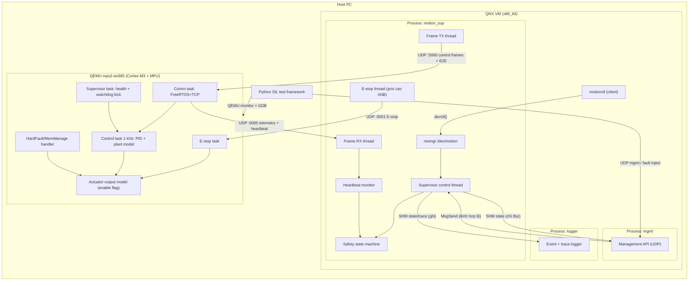

# Architecture — QNX–FreeRTOS Safety-Supervised Motion Control Platform

> Trạng thái: **FINAL v1.0** (2026-11-04).

## 1. Sơ đồ tổng thể



## 2. Môi trường chạy và đường kết nối

| Thành phần | Cấu hình |
|---|---|
| QNX | QNX SDP 8.0 (license non-commercial, cần tài khoản myQNX); VM x86_64 tạo bằng QNX Toolkit for VS Code + VMware (`mkqnximage`), network bridge/host-only với host |
| FreeRTOS | `qemu-system-arm -M mps2-an385`, NIC LAN9118 (`0x40200000`), FreeRTOS+TCP, IP tĩnh. Code nền: demo `FreeRTOS/Demo/CORTEX_MPU_M3_MPS2_QEMU_GCC` (MPU) + `FreeRTOS-Plus/Demo/FreeRTOS_Plus_TCP_Echo_Qemu_mps2` (TCP/IP) — hai demo tách rời, phải gộp ở M0 |
| Kết nối | QEMU dùng `-netdev tap` (hoặc `-netdev user` + `hostfwd` cho UDP); QNX VM và QEMU cùng subnet host-only |
| Port | `5000/udp` control + telemetry, `5001/udp` E-stop, `6000/udp` management |
| Debug | `qemu ... -s -S` + `arm-none-eabi-gdb`; QNX: `pidin`, `slog2info`, `on -p`, System Profiler (`tracelogger`) |

**M0 gate:** trước mọi milestone khác phải chứng minh được UDP echo 2 chiều giữa process QNX và task FreeRTOS trong QEMU. Đây là nền móng của toàn bộ project.

## 3. QNX Central Supervisor

### 3.1 Process và cách ly
| Process | Quyền | Vai trò |
|---|---|---|
| `motion_sup` | Ghi SHM `state`, ghi SHM `trace` | Logic chính, giao tiếp FreeRTOS, safety state machine, resmgr |
| `logger` | Đọc SHM `state`, đọc SHM `trace` | Ghi event log và trace ra file, xoay vòng file |
| `mgmt` | Chỉ đọc SHM `state` | Trả trạng thái/telemetry cho tool bên ngoài, chuyển lệnh hợp lệ vào `motion_sup` qua `MsgSend` |

- SHM tạo bằng `shm_open()` + `mmap()`; process chỉ đọc mở với `O_RDONLY` + `PROT_READ`. Ghi vào vùng chỉ đọc gây `SIGSEGV` — dùng làm một kịch bản fault injection để chứng minh memory protection giữa các process.
- Đồng bộ SHM bằng seqlock (writer duy nhất, reader không khóa) để tránh reader làm chậm control thread.
- Process crash được phát hiện bằng QNX `procmgr_event`/death pulse; `logger`/`mgmt` crash không ảnh hưởng control; `motion_sup` crash → FreeRTOS mất heartbeat → tự SAFE_STOP (xem mục 6).

### 3.2 Thread trong `motion_sup`
| Thread | Policy / priority | Chu kỳ | Nhiệm vụ |
|---|---|---|---|
| E-stop | `SCHED_FIFO` 60 | Event | Gửi E-stop frame trên socket riêng, lặp lại 3 lần cách nhau 1 ms |
| Heartbeat monitor | `SCHED_FIFO` 55 | 5 ms (timer pulse) | Kiểm tra timeout heartbeat/telemetry, kích hoạt chuyển trạng thái |
| Supervisor control | `SCHED_FIFO` 50 | 10 ms (timer pulse) | Sinh trajectory/setpoint, gửi command, kiểm tra giới hạn |
| Frame RX | `SCHED_FIFO` 45 | Event | Nhận UDP, kiểm tra E2E, cập nhật state |
| Frame TX | `SCHED_FIFO` 45 | Event | Đóng gói frame + E2E, gửi UDP |
| resmgr pool | `SCHED_RR` 20 | Event | Xử lý `open/devctl/read` từ client |

- Timer: `timer_create(CLOCK_MONOTONIC, SIGEV_PULSE)` gửi pulse vào channel của thread.
- Mutex dùng priority inheritance (mặc định của QNX); có test cố ý tạo priority inversion để chứng minh và đo.
- CPU budget: đo bằng System Profiler, mục tiêu mỗi chu kỳ control < 20% thời gian chu kỳ trong VM.

### 3.3 Resource manager `/dev/motion`
| `devctl` | Quyền | Mô tả |
|---|---|---|
| `DCMD_MOTION_GET_STATUS` | Mọi client | Trạng thái FSM, lỗi, counters |
| `DCMD_MOTION_SET_TARGET` | Group `motion` | Đặt vị trí mục tiêu, kiểm tra biên |
| `DCMD_MOTION_ENABLE` / `DISABLE` | Group `motion` | Bật/tắt điều khiển |
| `DCMD_MOTION_ESTOP` | Mọi client | Dừng khẩn |
| `DCMD_MOTION_RESET_FAULT` | Group `motion` | Xóa lỗi, chỉ hợp lệ trong SAFE_STOP |

- Kiểm tra quyền bằng `ConnectClientInfo()` (uid/gid) — "secure IPC" theo đúng JD.
- Validate kích thước payload, giá trị biên (vị trí, tốc độ) trước khi xử lý; trả `EINVAL`/`EPERM` khi sai.

## 4. Safety State Machine

```
        +--------+  self-test OK  +---------+  enable   +-------+
        |  INIT  | -------------> |  READY  | --------> |  RUN  |
        +--------+                +---------+           +-------+
                                       ^                  |    |
                                       | reset fault      |    | timeout ngắn / lỗi E2E lặp
                                       |                  |    v
                                  +-----------+  timeout  +----------+
                                  | SAFE_STOP | <-------- | DEGRADED |
                                  +-----------+           +----------+
                                       ^   E-stop / fault nặng (từ mọi trạng thái)
```

| Transition | Điều kiện | Phản ứng |
|---|---|---|
| RUN → DEGRADED | Mất 3 heartbeat liên tiếp (30 ms) hoặc ≥ 3 lỗi E2E trong 100 ms | Giới hạn tốc độ 20%, giữ vị trí |
| DEGRADED → RUN | 10 heartbeat hợp lệ liên tiếp | Khôi phục |
| DEGRADED → SAFE_STOP | Mất 10 heartbeat (100 ms) | Gửi E-stop, disable output |
| Mọi trạng thái → SAFE_STOP | E-stop, vượt giới hạn vị trí/tốc độ, fault record từ node | Disable output, ghi fault |
| SAFE_STOP → READY | `RESET_FAULT` + nguyên nhân đã hết | Chỉ bằng lệnh có quyền |

FreeRTOS node chạy state machine tương ứng ở phía mình: mất command quá 50 ms → tự đưa output về disable (fail-safe cục bộ, không phụ thuộc QNX).

## 5. FreeRTOS Motion Node

### 5.1 Task
| Task | Priority | Chu kỳ | Chế độ MPU | Nhiệm vụ |
|---|---|---|---|---|
| E-stop | Cao nhất | Event | Privileged | Nhận E-stop socket riêng, disable output ngay |
| Control | Cao | 1 ms (`vTaskDelayUntil`) | Restricted | PID vị trí/tốc độ, plant model, kiểm tra giới hạn |
| Comm | Trung bình | Event + 10 ms | Restricted | Nhận command, kiểm tra E2E, gửi telemetry + heartbeat |
| Supervisor | Thấp hơn Comm | 10 ms | Privileged | Kiểm tra "alive counter" của các task, kick watchdog chỉ khi tất cả task khỏe |
| Idle hook | Thấp nhất | — | — | Đo CPU load |

- Giao tiếp giữa task: queue (command), task notification (sự kiện), double buffer (telemetry).
- **MPU:** dùng port `ARM_CM3_MPU`, control task chỉ truy cập vùng nhớ của nó + vùng shared command/state; truy cập ngoài vùng → MemManage fault.

### 5.2 Control loop & plant model
- Plant: motor DC bậc 2 (điện + cơ), tham số cấu hình được, tích phân Euler/RK2 theo chu kỳ 1 ms.
- Encoder model: lượng tử hóa (vd 4096 count/vòng) + nhiễu Gaussian + tùy chọn bị đứng (stuck) để fault injection.
- Controller: PID cascade (vị trí → tốc độ), anti-windup, saturation, rate limit, giới hạn vị trí mềm.
- Bằng chứng: đồ thị step response (overshoot, settling time, steady-state error) và jitter chu kỳ.

### 5.3 Fault handling
| Cơ chế | Hành vi |
|---|---|
| Command timeout | > 50 ms không có command hợp lệ → disable output, báo trạng thái |
| E2E error | Frame sai CRC/counter/data ID bị loại, tăng counter, báo trong telemetry |
| Task health | Supervisor task chỉ kick watchdog khi mọi task đã báo alive trong chu kỳ |
| Watchdog | CMSDK APB watchdog (`0x40008000`) trên QEMU mps2: hết hạn lần 1 → **NMI** (handler ghi fault record vào `.noinit`, tắt actuator enable); hết hạn lần 2 (RESEN=1) → QEMU thực hiện system reset (`-action watchdog=reset`, mặc định). Đối chiếu lại source `hw/arm/mps2.c` và `hw/watchdog/cmsdk-apb-watchdog.c` ở M0 và ghi vào `sil_environment.md` |
| HardFault / MemManage | Handler tối giản: ghi trực tiếp thanh ghi để disable output model, lưu fault record (PC, LR, CFSR, MMFAR) vào vùng RAM `.noinit`, rồi reset. Sau reboot, gửi fault record trong heartbeat đầu tiên |
| Stack overflow | `configCHECK_FOR_STACK_OVERFLOW = 2` → xử lý như fault nặng |

Lưu ý thiết kế: handler fault không gửi mạng và không gọi API FreeRTOS — chỉ làm việc tối thiểu, an toàn; báo lỗi sau khi reboot.

## 6. Giao thức truyền

### 6.1 Frame (tương thích CAN FD, truyền qua UDP)
| Field | Size | Mô tả |
|---|---|---|
| `magic` | 2 B | `0xCAFD` |
| `can_id` | 2 B | 11-bit ID |
| `flags` | 1 B | FDF, BRS (giữ cho tương thích CAN FD) |
| `dlc` | 1 B | Độ dài data theo bảng DLC CAN FD (0–8, 12, 16, 20, 24, 32, 48, 64) |
| `data` | 0–64 B | `[E2E header 12 B][app payload theo DBC][padding về DLC hợp lệ]` |

Một UDP datagram chứa đúng một frame. Vì UDP không có arbitration/ACK, **ưu tiên E-stop được hiện thực ở tầng ứng dụng**: socket riêng, thread/task ưu tiên cao nhất, gửi lặp.

### 6.2 E2E protection (cấu trúc theo AUTOSAR E2E Profile 4)
Header 12 byte đặt ở đầu `data` (little-endian):

| Field | Size | Mô tả |
|---|---|---|
| `length` | 2 B | Tổng độ dài (header + app payload, chưa tính padding) |
| `counter` | 2 B | Tăng mỗi frame, **riêng cho từng Data ID** |
| `data_id` | 4 B | ID cố định mỗi message (bảng 6.3); chống nhầm message |
| `crc32` | 4 B | CRC-32P4: poly `0xF4ACFB13`, init `0xFFFFFFFF`, reflect in/out, xorout `0xFFFFFFFF`; tính trên `length‖counter‖data_id‖app payload` |

Bên nhận trả một trong: `OK`, `REPEATED`, `WRONG_SEQ` (delta counter > `MaxDelta` = 2), `CRC_ERR`, `LEN_OR_ID_ERR`, `TIMEOUT` (theo từng message) → đưa vào safety FSM.

Phạm vi trung thực: hiện thực theo **cấu trúc** Profile 4, kiểm tra bằng unit test với vector tự tính độc lập bằng Python; **chưa** đối chiếu test vector chính thức của AUTOSAR → gọi là "Profile 4–based", không gọi "compliant". Task ở M2: đối chiếu lại tham số CRC/layout với `AUTOSAR_PRS_E2EProtocol` trước khi chốt.

### 6.3 Message table (nguồn: `common/can_matrix.dbc`)
| CAN ID | Data ID | Hướng | Chu kỳ | Nội dung | Timeout bên nhận |
|---|---|---|---|---|---|
| `0x010` | `0x0010` | QNX → FreeRTOS | Event (port 5001, gửi 3 lần) | E-stop (có E2E) | — |
| `0x100` | `0x0100` | QNX → FreeRTOS | 10 ms | Mode, target position, velocity limit | 50 ms |
| `0x180` | `0x0180` | FreeRTOS → QNX | 10 ms | Position, velocity, current (model), output state | 30 ms |
| `0x1F0` | `0x01F0` | FreeRTOS → QNX | 10 ms | Heartbeat: node state, alive counter, CPU load, fault code | 30 ms |
| `0x1F1` | `0x01F1` | FreeRTOS → QNX | Event | Fault record sau reboot | — |

## 7. Tiêu chí timing và cách đo

Hai node chạy trên hai đồng hồ khác nhau (VMware vs QEMU, có thể `-icount`), nên **tiêu chí pass/fail dùng đại lượng tất định** (đếm tick/chu kỳ trên *cùng một* đồng hồ); số đo ms chỉ là thông tin SIL kèm nhãn.

| Hành vi | Tiêu chí pass/fail (tất định) | Số đo SIL (tham khảo, ghi nhãn) |
|---|---|---|
| Node mất command | Output disable khi không có CMD hợp lệ trong **50 tick** 1 ms của chính node (+1 tick) | — |
| QNX mất heartbeat | DEGRADED sau **3** chu kỳ 10 ms (timer pulse) bị mất; SAFE_STOP sau **10** | thời gian host ≈ 30 / 100 ms ± 10 ms |
| E-stop | Output disable trong **≤ 1 control tick** sau khi E-stop task xử lý frame hợp lệ; frame gửi 3 lần | lệnh → disable, đo bằng trace phía node, mục tiêu < 10 ms |
| QNX `motion_sup` crash | Node tự disable sau ≤ 50 tick mất command | ≤ 60 ms host |
| Jitter control task | Đo bằng DWT cycle counter (đơn vị cycle, **thời gian ảo** khi `-icount`) | p99 / max, vẽ histogram |
| Round-trip command → telemetry | Đo **chỉ trên đồng hồ QNX** (`CLOCK_MONOTONIC`): thời điểm gửi CMD counter *n* → thời điểm nhận telemetry echo counter *n* | p50/p99/max, không có mục tiêu cứng |

Mọi số liệu ms ghi rõ "SIL trên VM/QEMU, không phải hard real-time".

## 8. Safety concept
Safety goals và FMEA-lite (ánh xạ mỗi failure mode → cơ chế phát hiện → phản ứng → kịch bản test) nằm trong [safety_concept.md](safety_concept.md). Đây là tài liệu *theo tinh thần* ISO 26262, không phải work product chính thức.

## 9. Bộ công cụ Python
| Công cụ | Chức năng |
|---|---|
| `dbc_codegen.py` | Sinh header C pack/unpack từ `can_matrix.dbc` |
| `frame_sniffer.py` | Bắt và giải mã frame UDP (DBC + E2E) |
| `udp_proxy.py` | Proxy giữa QNX và QEMU: drop/delay/duplicate/corrupt/reorder cho fault injection |
| `sil_runner.py` | Khởi động QEMU, kết nối QNX VM, chạy scenario |
| `fault_inject/` | pytest scenario: drop/delay/duplicate/corrupt frame, kill process, stuck encoder, MPU violation |
| `metrics.py` | Tính jitter, latency p50/p99/max, reaction time; xuất báo cáo |
| `plot_step.py` | Vẽ step response và histogram latency |
